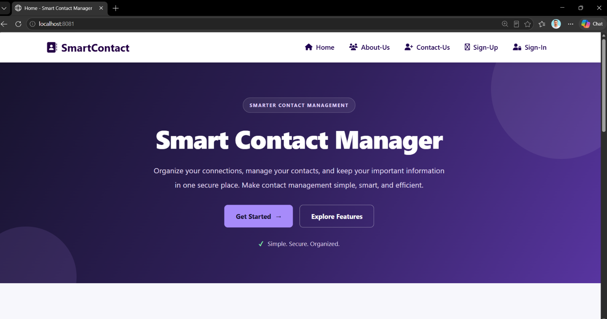
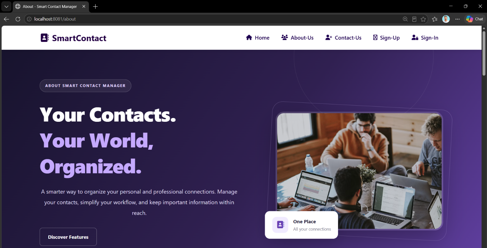
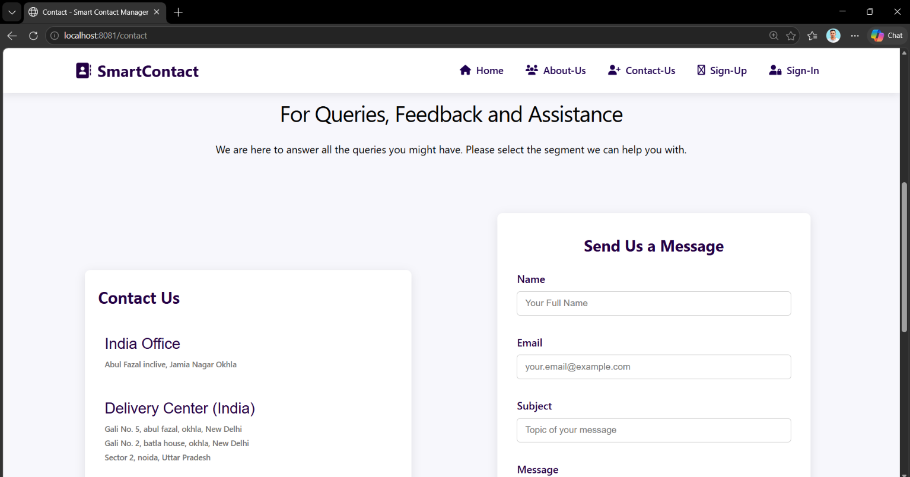
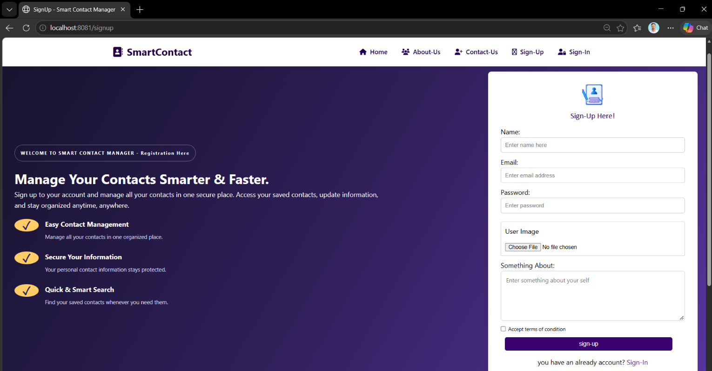
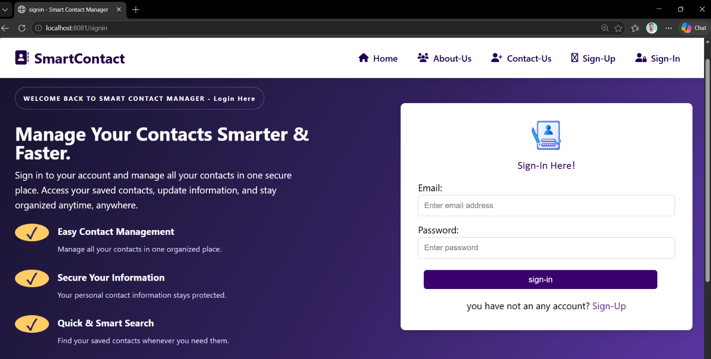

# Smart Contact Manager 🚀
A web-based Smart Contact Manager application developed using Java and Spring Boot. It provides a secure and efficient way to store, manage, and organize personal contacts.

## 📌 Project Overview
Smart Contact Manager is a web application that allows users to register, log in, manage their profiles, and maintain their contacts in one place.

## ✨ Features
- User Registration and Login
- Secure Authentication / Authorization using Spring Security
- Add, View, Update and Delete Contacts
- Upload Contact Profile Images
- User Profile Management
- Search and Pagination
- Responsive Dashboard
- Contact Management System
- Database Integration

## 🛠️ Technologies Used
**Frontend**
- HTML5
- CSS3
- JavaScript
- Bootstrap
- Thymeleaf

**Backend**
- Java
- Spring Boot
- Spring Security
- Spring MVC
- Spring Data JPA

**Database**
- MySQL

**Tools**
- Maven
- Git & GitHub
- IntelliJ IDEA / Spring Tool Suite
- Postman

## 📂 Project Structure
```text
SmartContactManager/
│
├── src/
│   ├── main/
│   │   ├── java/
│   │   │   └── in/sp/main/
│   │   │       ├── Controller/
│   │   │       ├── Model/
│   │   │       ├── Repository/
│   │   │       ├── Service/
│   │   │       └── Configuration/
│   │   │
│   │   └── resources/
│   │       ├── static/
│   │       ├── templates/
│   │       └── application.properties
│   │
│   └── test/
│
├── pom.xml
└── README.md
```
## ⚙️ Installation and Setup

1. Clone the repository:

```bash
git clone YOUR_GITHUB_REPOSITORY_URL
```
2. Open the project in IntelliJ IDEA or Spring Tool Suite.
3. Configure your MySQL database in `application.properties`.
4. Update your database credentials.
5. Run the Spring Boot application.
6. Open your browser and visit: http://localhost:8080

## 🗄️ Database Configuration
Configure your MySQL database in `application.properties`:

# properties
1. spring.datasource.url=jdbc:mysql://localhost:3306/smartcontactmanager
2. spring.datasource.username=r**t
3. spring.datasource.password=Saif***90.
4. spring.jpa.hibernate.ddl-auto=update
5. spring.jpa.show-sql=true

**Important:** Never upload your actual database password or other secret credentials to GitHub.
## 👨‍💻 Developer

**Saif Ali**
Java Full-Stack Developer
Interested in Java, Spring Boot, REST APIs, Microservices and building real-world applications.

## 📄 License
This project is created for learning and educational purposes and for personal use.

## 📸 Application Screenshots

### 🏠 Home Page


### 👨‍💻 About Us Page


### 📩 Contact Us Page


### 📝 Sign Up Page


### 🔐 Sign In Page


